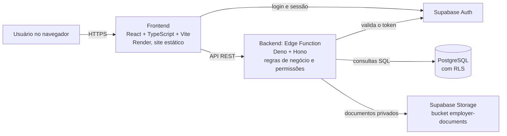

# Trabalhador Brasileiro

Plataforma web que conecta pessoas em vulnerabilidade financeira a vagas de emprego e a programas sociais, e que mostra, com simuladores, o peso real do salário mínimo no orçamento de uma família. Projeto da disciplina **Laboratório de Engenharia de Software** (Universidade Presbiteriana Mackenzie).

[](https://github.com/11114444y/Projeto-do-lab-de-engenharia-de-software/actions/workflows/testes.yml)

| | |
|---|---|
| **Aplicação publicada** | <https://projeto-do-lab-de-engenharia-de-software.onrender.com/> |
| **Vídeo de demonstração (até 2 min)** | |
| **Segurança e limitações** | [Seção 2.5](#25-segurança-e-limitações) |
| **Especificação inicial (TG1)** | [Anexo ao final deste documento](#4-anexo-especificação-preliminar-tg1) |

## Integrantes

| Nome | RA |
|---|---|
| Geovana Bomfim | 10410514 |
| Yating Zheng | 10439511 |
| Gabriel Teixeira Bolonha | 10426937 |
| Vitor Neudl Gandolfi | 10408845 |

## Sumário

1. [Apresentação executiva](#1-apresentação-executiva)
2. [Testes automatizados e deploy](#2-testes-automatizados-e-deploy)
3. [Estrutura do repositório](#3-estrutura-do-repositório)
4. [Anexo: especificação preliminar (TG1)](#4-anexo-especificação-preliminar-tg1)

---

## 1. Apresentação executiva

### 1.1 Retomada dos objetivos

No Brasil, muitas pessoas vivem com insegurança financeira: não sabem se vão conseguir fazer a compra do mês ou pagar aluguel, água e luz. Isso acontece por desemprego, por salários que não sustentam uma casa ou por trabalho informal, sem benefícios. A especificação da TG1 identificou três causas raízes, e cada uma virou um objetivo do projeto:

| Causa raiz (TG1) | Objetivo | Como foi atendido |
|---|---|---|
| Não existe um banco de vagas voltado à baixa renda | Reunir vagas de empresas verificadas em um só lugar | Banco de vagas com busca e filtros; só empregadores aprovados por um administrador publicam |
| É preciso conscientizar sobre a insuficiência do salário-mínimo | Mostrar o orçamento real de quem ganha pouco | Simulador salarial (INSS, IRRF e FGTS de 2026) e simulador de vida, em forma de jogo, com 8 cidades |
| As informações sobre benefícios e ONGs estão dispersas | Centralizar esses serviços com fontes confiáveis | Central de ajuda com programas sociais, serviços e ONGs, cada um com fonte oficial e data de verificação |

**Escopo (fronteira sistêmica da TG1).** Dentro: cadastro de vagas, banco de vagas e simulador. Fora: o processo seletivo em si e a garantia de acesso aos auxílios e ONGs listados.

**Restrições da TG1 e como ficaram:**

| Restrição | Situação |
|---|---|
| Técnica: funcionar em celular e computador, mesmo com rede instável | Interface em React com Tailwind. Quando o backend não responde, a tela mostra um aviso e um botão para tentar de novo. **Não há modo offline**, e o uso em celular não foi testado de forma sistemática |
| Segurança: dados protegidos e acesso por autenticação | Login com Supabase Auth, RLS ativo em todas as tabelas, permissões por papel validadas no servidor, documentos em bucket privado e nenhuma chave privada no frontend |
| Legal: leis trabalhistas e privacidade | CPF e CNPJ são validados e empresas só publicam após aprovação. **Ainda não há aviso de privacidade nem fluxo de exclusão de dados (LGPD)**; veja os pontos de melhoria |

### 1.2 Principais funcionalidades alcançadas

| Perfil | O que consegue fazer |
|---|---|
| **Visitante** | Usar o **simulador salarial** (salário bruto de R$ 1.621 a R$ 30.000, com INSS, IRRF, FGTS e líquido pelas tabelas de 2026) e o **simulador de vida**, um jogo de 4 semanas em 8 cidades (São Paulo, Rio de Janeiro, Belo Horizonte, Porto Alegre, Salvador, Fortaleza, Recife e Manaus), com contas a pagar, mercado, transporte, saúde e indicadores de fome, saúde e energia, além de um resumo financeiro ao final |
| **Trabalhador** | Cadastro com CPF validado e perfil profissional; busca de vagas com filtros (área, tipo de contrato, estado e salário mínimo); candidatura, acompanhamento do status e retirada da candidatura; notificações; histórico das simulações; Central de Ajuda com programas sociais e serviços |
| **Empregador** | Cadastro com CNPJ validado e declarações; envio de documento da empresa (PDF, JPG ou PNG, até 5 MB) para revisão; depois de aprovado, publica, edita, prorroga e arquiva vagas; vê os candidatos e altera o status (Em análise, Entrevista, Aprovado, Reprovado), o que notifica o trabalhador |
| **Administrador** | Revisa os documentos das empresas e aprova ou rejeita com observação; arquiva vagas |

Não há vagas fictícias no fluxo: toda vaga é publicada por um empregador aprovado. O catálogo de programas sociais é cadastrado com fonte e data de verificação (Ministério do Desenvolvimento Social, Prefeitura de São Paulo, SINE e as organizações Instituto PROA e Gerando Falcões); as tabelas de INSS e IRRF vêm do INSS e da Receita Federal.

### 1.3 Desenho da arquitetura



A arquitetura segue as quatro camadas definidas na TG2:

| Camada | Onde está |
|---|---|
| Apresentação | Frontend React + TypeScript (`src/`), publicado no Render |
| Negócio | Edge Function `make-server-813cc0a8` (`supabase/functions/`): valida CPF e CNPJ, papéis, aprovação de empresas, propriedade das vagas e candidaturas duplicadas |
| Persistência | A função acessa o banco com a chave de serviço, que existe só no servidor |
| Banco de dados | PostgreSQL gerenciado pelo Supabase (`supabase/migrations/`) |

**Segurança em uma frase:** o navegador conhece só a chave pública; toda escrita passa pela função, que confere a sessão e o papel do usuário (`worker`, `employer` ou `admin`) antes de tocar no banco.

**Modelo de dados principal:** `profiles` (usuários e perfis), `jobs` (vagas), `applications` (candidaturas), `simulations` e `expenses` (simulações e despesas), `notifications`, `employer_documents` (documentos de empresas), `locations`, `social_programs`, `data_sources`, `program_sources` e `simulation_sources` (catálogo de programas e suas fontes).

Os diagramas UML da TG1 continuam em `docs/diagramas/`: [casos de uso](docs/diagramas/Diagrama_CasosDeUso.png), [classes de domínio](docs/diagramas/Diagrama_ClassesDominio.png) e [sequência](docs/diagramas/Diagrama_Sequencia.png).

### 1.4 Pontos de melhoria e evolução

| Área | Melhoria proposta |
|---|---|
| Testes | Hoje os testes de rede só leem dados. Falta cobrir as regras de negócio (candidatura duplicada, papel errado, vaga de outra empresa) com um Supabase local no GitHub Actions e testes de ponta a ponta no navegador |
| Privacidade (LGPD) | Aviso de privacidade, consentimento no cadastro, exclusão de conta e política de retenção para CPF, CNPJ e documentos |
| Administração | Tela para criar e gerenciar administradores (hoje a promoção é feita por SQL) e para editar o catálogo de programas sociais |
| Verificação de empresas | Consultar o CNPJ em uma fonte oficial, para reduzir a revisão manual de documentos |
| Segurança de operação | Restringir o CORS ao site publicado, limitar a taxa de chamadas ao cadastro e usar um serviço de e-mail próprio para reativar a confirmação de e-mail |
| Escalabilidade | Paginar a busca de vagas no servidor (hoje a lista é carregada de uma vez) |
| Experiência de uso | Funcionar com rede instável (cache e reenvio), validar o uso em celular e revisar a acessibilidade |
| Manutenção | Atualizar anualmente as tabelas de INSS e IRRF e a data de verificação dos programas; tornar as migrações reexecutáveis; gerar documentação automática do código |

### 1.5 Potencial de continuidade

**O grupo não pretende dar continuidade ao projeto** como TCC, iniciação científica ou incubadora. O repositório está documentado e pode ser reproduzido do zero com o processo da seção 2.2, para que outras pessoas retomem o trabalho, se quiserem. As possibilidades abaixo são observações do grupo, não planos:

- **TCC ou IC:** avaliar se simuladores como o de vida mudam a percepção sobre o salário-mínimo, ou estudar mecanismos de verificação de empresas.
- **Incubadora:** exigiria um modelo de sustentação (a plataforma foi pensada sem cobrar prioridade de vagas), parcerias com ONGs e órgãos públicos e adequação formal à LGPD.

### 1.6 Como executar a aplicação


> **<https://projeto-do-lab-de-engenharia-de-software.onrender.com/>**

O site já está conectado ao Supabase do projeto (banco, autenticação e backend publicados).

**Para desenvolver ou rodar os testes: GitHub Codespaces.** 

1. No repositório, clique em **Code → Codespaces → Create codespace on main**. O ambiente (Node 22 e `pnpm`) é montado pelo `.devcontainer`, e as dependências são instaladas ao final.
2. No terminal, rode `pnpm dev`, e abra a porta **5173** (aba *Portas*, rótulo "Frontend").
3. Para os testes, rode `pnpm test`.

**Credenciais (só no Codespaces).** O frontend precisa de `VITE_SUPABASE_URL` e `VITE_SUPABASE_ANON_KEY` (a chave pública *publishable*, que não é segredo). Elas ficam nos *Codespaces secrets* do repositório (*Settings → Secrets and variables → Codespaces*), e o Codespaces as entrega ao ambiente automaticamente. Se o site abrir sem conseguir entrar ou listar dados, as variáveis não chegaram: crie o arquivo `.env` com `cp .env.example .env`, preencha os dois valores (peça ao grupo) e reinicie o `pnpm dev`. O `.env` está no `.gitignore` e nunca deve ser enviado ao GitHub.

**Fluxo para experimentar:** cadastrar um empregador (com CNPJ válido de teste) e enviar o documento; entrar como administrador e aprovar a empresa; publicar uma vaga; com outra conta de trabalhador (CPF válido de teste), candidatar-se; como empregador, mudar o status e ver a notificação. Use apenas dados fictícios.

---

## 2. Testes automatizados e deploy

### 2.1 Testes automatizados no GitHub Actions

O workflow [`testes.yml`](.github/workflows/testes.yml) roda a cada push e pull request na `main` (e manualmente): instala as dependências com `pnpm install --frozen-lockfile`, executa `pnpm test` e compila a aplicação. Os testes usam o executor nativo do Node (`node --test`) e estão em `tests/`:

| Arquivo | Qtde | O que verifica |
|---|---|---|
| `project-contract.test.mjs` | 4 | Todas as rotas chamadas pelo frontend existem no backend; tabelas e RLS presentes na migração; rotas de escrita exigem login e papel; nenhuma chave privada no frontend |
| `completion-contract.test.mjs` | 4 | Migração do domínio completo; validações de cadastro, aprovação de empresa e propriedade da vaga; frontend sem vagas falsas; documentação presente |
| `backend-routing.test.mjs` | 1 | A função usa o nome certo como prefixo das rotas e o frontend chama a mesma URL |
| `frontend-build.test.mjs` | 2 | Tailwind ativo no build; página sem marcações de rascunho |
| `salary-2026.test.mjs` | 3 | Cálculo de INSS progressivo, isenção e redução do IRRF e FGTS conforme as tabelas de 2026 |
| `endpoints-http.test.mjs` | 11 | Chamadas HTTP reais à função publicada: `/health` (200), `/bootstrap` (listas), cadastro inválido (400) e 7 rotas protegidas recusando acesso anônimo (401) |

São **25 testes**. Os 11 testes HTTP só rodam quando a variável `SUPABASE_FUNCTION_URL` está definida; no GitHub Actions ela vem do *secret* de mesmo nome (*Settings → Secrets and variables → Actions*), com o valor `https://SEU-REF.supabase.co/functions/v1/make-server-813cc0a8`. Sem ele, esses testes são ignorados e o workflow continua passando. Os testes HTTP só leem dados e não criam contas nem registros.

```bash
pnpm test                                    # os 14 testes locais
SUPABASE_FUNCTION_URL=https://SEU-REF.supabase.co/functions/v1/make-server-813cc0a8 pnpm test   # os 25
pnpm run test:smoke                          # verificação rápida da função publicada
```

**Limite atual:** os testes de rede checam o contrato (códigos 200, 400 e 401), mas ainda não exercitam as regras de negócio com contas reais; isso está nos pontos de melhoria.

### 2.2 Processo de deploy

A aplicação roda em três serviços gratuitos, e o último passo de cada etapa pode ser conferido na URL indicada.

1. **Banco (Supabase).** As duas migrações foram executadas no *SQL Editor*, em ordem. A segunda também cria o bucket privado de documentos e o catálogo inicial de programas sociais.
2. **Backend (Supabase Edge Functions).** Publicado pela linha de comando:
   `npx supabase functions deploy make-server-813cc0a8 --project-ref SEU-REF --no-verify-jwt`.
   Conferência: `https://SEU-REF.supabase.co/functions/v1/make-server-813cc0a8/health` responde `{"status":"ok", ...}`. Há também o workflow manual [`deploy-backend.yml`](.github/workflows/deploy-backend.yml), que publica a mesma função e testa o `/health`.
3. **Frontend (Render, *Static Site*).** Conectado ao repositório, branch `main`, com:
   - *Build Command:* `pnpm install --frozen-lockfile && pnpm run build`
   - *Publish Directory:* `dist`
   - Variáveis: `VITE_SUPABASE_URL` e `VITE_SUPABASE_ANON_KEY` (chave pública *publishable*).
4. **Ajustes finais no Supabase.** URL do Render em *Site URL*, confirmação de e-mail desativada para a demonstração e criação do primeiro administrador por SQL.

As variáveis `VITE_` são lidas na compilação: ao mudar uma delas, é preciso publicar o frontend de novo.

As migrações não são idempotentes: repetir uma delas gera erro de restrição já existente. O Render usa Node 24 por padrão e o build funciona; para fixar a versão, defina `NODE_VERSION=22`.

**Variáveis de ambiente** (modelo em `.env.example`):

| Variável | Onde | Valor |
|---|---|---|
| `VITE_SUPABASE_URL` | frontend | `https://SEU-REF.supabase.co` |
| `VITE_SUPABASE_ANON_KEY` | frontend | chave *publishable* do projeto |
| `ALLOWED_ORIGIN` (opcional) | Edge Function | URL do site, para restringir o CORS (padrão `*`): `npx supabase secrets set ALLOWED_ORIGIN=https://SEU-SITE.onrender.com --project-ref SEU-REF` |

`SUPABASE_URL`, `SUPABASE_ANON_KEY` e `SUPABASE_SERVICE_ROLE_KEY` são injetadas pelo Supabase dentro da função; a chave `service_role` nunca vai para o navegador.

### 2.3 Demonstração em produção

Vídeo ainda não foi produzido

### 2.4 Dificuldades e experiências no deploy

- **Nome da função no caminho das rotas.** O Supabase envia à função o nome dela como prefixo da rota. Havia duas cópias da função, uma com o prefixo configurado e outra sem, e o workflow publicava a cópia que o frontend não chamava. Ficou uma função só e um teste (`backend-routing`) para impedir a regressão.
- **Um bug que só apareceu no uso real.** Nos formulários de cadastro e de nova vaga, o campo perdia o foco a cada letra digitada. A causa eram componentes declarados dentro de outros componentes, que o React recria a cada tecla. A correção foi movê-los para fora (PR #12). Os testes automatizados não pegariam isso, o que mostra o valor de testar o site publicado.
- **Teste que passava sem proteger nada.** Um teste só conferia se um arquivo de documentação existia, e o arquivo estava vazio. Passamos a verificar o conteúdo do README, porque um teste precisa checar o que importa.
- **Primeiro administrador.** A plataforma só aceita cadastro de trabalhador e empregador, então o primeiro administrador precisa ser promovido por SQL. Sem ele, ninguém aprova empresas, e sem empresas aprovadas não há vagas.
- **Variáveis de ambiente do Vite.** Elas só valem na compilação, então corrigir uma variável exige novo deploy no Render.
- **Gerenciador de pacotes.** O repositório usa `pnpm-lock.yaml`, mas o CI instalava com `npm`, o que ignora o lockfile. Alinhamos o CI e o Render para `pnpm install --frozen-lockfile`.
- **Avisos que não são erros.** O Supabase CLI avisa "Docker is not running" ao publicar a função, mas ela é publicada normalmente.
- **Plano gratuito.** Projetos gratuitos do Supabase são pausados após cerca de uma semana sem uso; é preciso abrir o painel antes de uma demonstração. O envio de e-mails do Supabase também tem limite baixo, por isso a confirmação de e-mail foi desativada para a demonstração.

### 2.5 Segurança e limitações

**Segurança**

- RLS ativo em todas as tabelas, sem políticas abertas: o acesso passa pela função, que valida a sessão (`auth.getUser`) e o papel do usuário (`worker`, `employer`, `admin`).
- Empresas só publicam vagas depois de aprovadas por um administrador.
- Documentos das empresas ficam em bucket privado (PDF, JPG ou PNG, até 5 MB); a revisão usa links temporários.
- Cada empregador só altera ou exclui as próprias vagas e só gerencia candidaturas das próprias vagas.
- Chaves privadas não ficam no frontend, e há teste automatizado que falha se `SUPABASE_SERVICE_ROLE_KEY` aparecer no código do navegador.

**Limitações conhecidas**

- Não há tela para criar administradores; a promoção é feita por SQL.
- O CORS é `*` enquanto `ALLOWED_ORIGIN` não for definido.
- Para uso real, configure SMTP próprio no Supabase e reative a confirmação de e-mail.
- Dados pessoais (CPF, CNPJ, documentos) exigem aviso de privacidade e base legal (LGPD) em uso real.
- Os programas sociais vêm de fontes oficiais com data de verificação; confirme as regras nos portais indicados.

---

## 3. Estrutura do repositório

```
.
├── src/                  Frontend (React + TypeScript)
│   ├── App.tsx           Telas e navegação
│   ├── SimGame.tsx       Simulador de vida
│   ├── Operations.tsx    Painéis de candidatos, verificação de empresas e administração
│   └── lib/              Cliente da API, Supabase e cálculo de salário
├── supabase/
│   ├── functions/make-server-813cc0a8/   Backend (Edge Function)
│   └── migrations/                       Esquema do banco
├── tests/                Testes automatizados
├── scripts/              Verificação rápida da função publicada
├── docs/                 Diagramas da TG1
├── .github/workflows/    Testes e deploy do backend (GitHub Actions)
└── .devcontainer/        Ambiente do GitHub Codespaces
```

---

## 4. Anexo: especificação preliminar (TG1)

<details>
<summary>Texto original da especificação preliminar da solução</summary>

### Definição do problema

No Brasil, milhares de pessoas passam por dificuldades financeiras que causam uma insegurança enorme no dia a dia, pois não sabem se vão conseguir fazer a compra do mês no mercado, se vão conseguir pagar o aluguel, a água ou a luz. Isso pode acontecer por alguns motivos, desde não ter emprego, ou a ter um emprego, porém não ganhar o suficiente, ou até mesmo por não ser um emprego registrado, e ganhar a abaixo do que deveria e sem benefícios. Isso é resultado de diversos fatores, seja o site de vagas que precisa pagar para ter prioridade de acesso, a falta de salários que consigam bancar uma vida atualmente.

### Causas raízes

* Ausência de banco de vagas exclusivos para pessoas baixa renda, sendo assim esse grupo de pessoas tem mais dificuldades de ter acesso a vagas que poderiam ajudar a sair da inseguridade financeira.
* Necessidade de conscientizar sobre a insuficiência do salário-mínimo para gerir uma residência atualmente.
* Centralização das informações sobre benefícios e locais que podem ajudar pessoas com inseguridade financeira.

### Stakeholders

**Visitantes** pessoas que buscam se informar sobre o assunto, com dados retirados de fontes confiáveis e unificados de maneira facilitada.

**Trabalhadores** são diretamente impactados por não ter um local focado para a distribuição de vagas para pessoas necessitadas.

**Contratantes** por vezes não sabem o real impacto do salário ofertado por sua empresa, e mesmo que saiba não tem um local para ajudar pessoas que procuram um salário digno.

### Fronteira sistêmica

Fará parte da proposta: cadastro de vagas, simulador e banco de vagas.

Não fará parte da proposta: processo eletivo da vaga e garantia de acesso aos auxílios e/ou ONGs listados.

O sistema irá conectar pessoas em vulnerabilidade financeira com pessoas que querem e podem ajudar, seja ofertando vagas ou doações em ONGs. Garantindo que somente pessoas que precisem tenham acesso as vagas nele cadastradas.

### Restrições

**Restrição técnica:** A solução deve suportar o acesso por meio de dispositivos móveis e computadores, e garantir o funcionamento normal, mesmo em áreas com conexões de rede instáveis. Deve também manter seus dados atualizados com as bases de dados.

**Restrição de segurança:** Todos os dados devem obedecer a protocolos rigorosos de segurança da informação para garantir confidencialidade, integridade e privacidade. O acesso ao sistema deve ser controlado por meio de autenticação de usuário.

**Restrições legais:** A solução deve estar em conformidade com as leis e regulamentos trabalhistas. Deve também respeitar os direitos de privacidade e confidencialidade.

Para mais informações, consultar a wiki do projeto.

</details>
